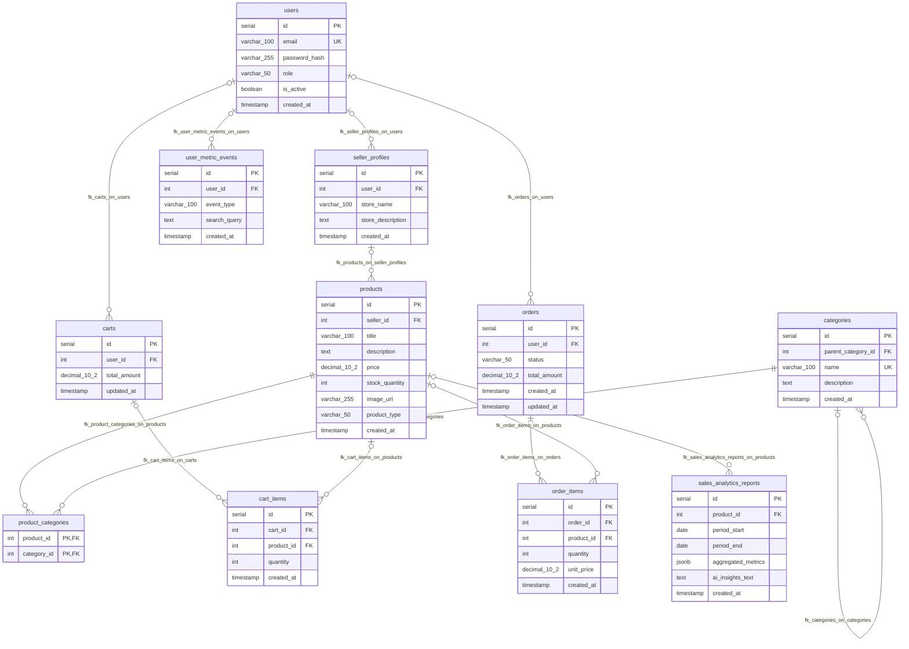

# Database schema diagram

This Mermaid ER diagram is based on [`schema.sql`](./schema.sql). Foreign-key columns are nullable unless marked `NOT NULL`.

`product_categories` is the junction table implementing the many-to-many relationship between `products` and `categories`.
